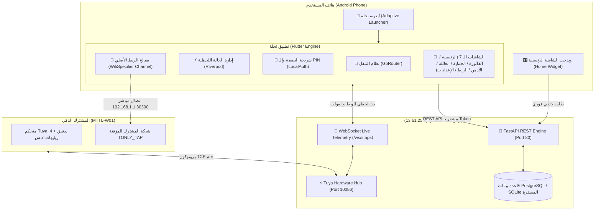

# خطة العمل التنفيذية الموسعة: تطبيق "نحلة IoT" للموبايل (Flutter Android APK)

تحدد هذه الوثيقة الخطة الهندسية الشاملة لتحويل منصة **نحلة IoT** والمشترك الذكي (MTTL-W01) إلى تطبيق أندرويد متكامل بصيغة `.apk`، مبني على أحدث معايير **Flutter 3.x**، ومطابق بنسبة 100% للتصور التجريبي المعتمد، ومتكامل بصورة مباشرة مع محرك الباك إند السحابي على AWS.

---

## 1. الأهداف المعمارية والمخرجات الرئيسية (System Objectives)

1. **بناء تطبيق Flutter أصلي (Native Android APK):** أداء فائق بمعدل 60-120 إطار في الثانية للرسومات والتفاعلات، بدون أي اعتماد على المتصفحات أو WebViews.
2. **اعتماد هوية نحلة وأيقونة التطبيق الرسمية:** استخدام التصميم المعتمد في `Gemini_Generated_Image_q6mfbxq6mfbxq6mf.jpg` مع توليد حزم الأيقونات المتكيفة (Adaptive Icons) لجميع كثافات شاشات أندرويد.
3. **تنفيذ تجربة الربط الهجينة السلسة (Zero-Friction Hybrid SoftAP):**
   - كشف شبكة المشترك `TONLY_TAP_*` تلقائياً عبر الأندرويد.
   - كشف شبكات الواي فاي المنزلية وعرضها كأزرار سريعة.
   - استخدام نافذة الربط الأصلية لأندرويد (`WifiNetworkSpecifier`) لحقن الباسورد `_LGU` برمجياً دون مغادرة التطبيق ودون انقطاع باقة الموبايل.
   - سؤال حماية الراوتر التلقائي فور نجاح الربط.
4. **منظومة الأمان المزدوجة (Biometric-First with PIN Fallback):**
   - فتح الفيش المقفولة ببصمة الإصبع أو الوجه فوراً (< 0.2 ثانية).
   - توفير كيبورد الـ PIN الذكي المكون من 4 أرقام كخيار بديل عند فشل البصمة.
5. **لوحة تحكم الأدمن المدمجة (In-App Admin Console):** كشف صلاحيات حساب المطور (`role == "ADMIN"`) تلقائياً وإتاحة إدارة العملاء، وتعديل الكوتة، ومراقبة المشتركات من شاشة الموبايل.
6. **ويدجت الشاشة الرئيسية (Android Home Screen Widgets):** ويدجت سريع 1x1 للمفتاح بلمسة واحدة، وويدجت 4x2 لبرطمان السحب والمخارج الأربعة.
7. **نظام الإشعارات الذكية الـ 4 (Smart Push Alerts):** حارس الجهد، اكتمال شحن الهاتف، حماية الراوتر من العبث، وتنبيه قفزات شرائح الكهرباء المصرية.
8. **خط التجميع السحابي التلقائي (GitHub Actions CI/CD):** بناء وتوقيع ملف `app-release.apk` سحابياً وتوفير رابط تحميل مباشر بضغطة زر.
9. **التدريع الأمني للسيرفر السحابي (Server Hardening):** إغلاق بورت 8080 نهائياً، تفعيل التشفير الإجباري HTTPS/WSS، وحظر محاولات التخمين (Rate Limiting).

---

## 2. مراجعة المستخدم والموافقات المطلوبة (User Review Required)

> [!IMPORTANT]
> **1. إعداد مستودع GitHub للبناء السحابي:**
> سنحتاج إلى رفع كود التطبيق على مستودع GitHub (سواء جديد أو الحالي) لتفعيل سكربت الـ GitHub Actions الذي سيقوم بتجميع ملف الـ `.apk` في دقائق دون الحاجة لتثبيت برامج ثقيلة كـ Android Studio على جهازك.
>
> **2. إغلاق بورت 8080 من الـ AWS Security Group:**
> بمجرد تشغيل واختبار التطبيق، سنقوم بإلغاء بورت 8080 المفتوح حالياً لتقليص مساحة الهجوم ومنع أي هجمات فحص عشوائية على السيرفر.
>
> **3. اسم الحزمة الرسمية للتطبيق (Package Name):**
> سنعتمد المعرّف الرسمي لنظام أندرويد: `com.na7la.iot.smartstrip`.

---

## 3. المخطط المعماري لمنظومة التطبيق (Architecture Diagram)



---

## 4. تفاصيل الشاشات والمكونات البرمجية المقترحة (Detailed Screen Breakdown)

### أ. الشاشة 1: الترحيب وتسجيل الدخول ودخول الضيوف (Auth & Guest Gateway)
* **المسار:** `lib/screens/auth/login_screen.dart`
* **المميزات:**
  - واجهة Neo-Brutalism زاهية مع شعار النحلة المتحرك.
  - إدخال الإيميل وكلمة المرور (`POST /api/v1/auth/login`).
  - تسجيل الدخول المباشر بحساب Google (`POST /api/v1/auth/google`).
  - **بوابة الضيوف الفورية:** زر بارز: *"معاك كود دعوة عائلي؟"* $\leftarrow$ إدخال الكود المكون من 6 أرقام (`POST /api/v1/auth/login-invite`)، والدخول فوراً للمخارج المصرح بها فقط دون إنشاء حساب.
  - **الحفظ الآمن للتوكن:** تخزين توكن الجلسة داخل `FlutterSecureStorage` مع تجديد تلقائي.

### ب. الشاشة 2: الخلية الرئيسية (Main Dashboard & Sockets)
* **المسار:** `lib/screens/home/home_dashboard_screen.dart`
* **المميزات:**
  - **محدد المشتركات (Strip Selector):** Dropdown أنيق في أعلى الشاشة يتيح التبديل بين مشتركات العميل (مشترك الصالة، مشترك المكتب، إلخ) مع إشارة اتصال حية (🟢 متصل / 🔴 غير متصل).
  - **برطمان قياس السحب (Interactive Honey Jar):**
    - أنيميشن لسائل العسل يرتفع وينخفض بنسبة التحميل اللحظية (0% - 100%).
    - مسطرة قياس مدرجة بتصميم نخلة الفريد.
    - عرض رقمي للواط، الأمبير، الفولت، وتكلفة اليوم بالجنيه المصري.
  - **الأزرار السريعة:**
    - `⚡ تشغيل الكل`: تشغيل كافة الفيش غير المقفولة.
    - `🛡️ إطفاء ذكي آمن`: إطفاء الأجهزة غير الحيوية مع الحفاظ الصارم على فيشة الراوتر والتلاجة.
  - **شبكة المخارج الأربعة (4 Independent Socket Cards):**
    - اسم الفيشة ورقمها وأيقونتها المخصصة.
    - الواط اللحظي الفعلي واستهلاك الكيلوواط التراكمي.
    - مؤشر القفل الذكي (`🔒` مقفول بـ PIN / `⚡` تحكم حر).
    - مفتاح التشغيل والإيقاف المتصل بالبصمة.
    - زر الترس `⚙️` لفتح نافذة الإعدادات العميقة.

### ج. الشاشة 3: النافذة العميقة للمخرج (Socket Deep-Dive Bottom Sheet)
* **المسار:** `lib/screens/home/widgets/socket_deep_dive_sheet.dart`
* **المميزات:**
  - **قوالب الأجهزة الذكية (One-Tap Appliance Presets):**
    - ❄️ **تلاجة:** تفعيل حماية الكمبريسور وتأخير 3 دقائق.
    - 🌀 **تكييف:** تفعيل حماية الكمبريسور وتأخير 5 دقائق.
    - 🌐 **راوتر:** قفل الفيشة برقم PIN وحمايتها ضد الإطفاء بالخطأ.
    - 📱 **شاحن:** تفعيل الفصل التلقائي عند اكتمال الشحن (أقل من 3W لمدة 10 دقائق).
    - 🔥 **سخان:** تفعيل دورة متكررة لحفظ الطاقة.
    - 📺 **شاشة / كمبيوتر:** حماية ضد تذبذب الكهرباء.
  - **مؤقتات الإيقاف السريعة (Auto-Off Timers):** أزرار جاهزة (15m, 30m, 1h, 2h) أو إدخال وقت مخصص.
  - **الدورات المتكررة (Cyclic Automation):** ضبط تشغيل 15 دقيقة كل ساعة مثلاً.
  - **سلوك المخرج بعد عودة الكهرباء (Power-on State):** (تشغيل ON / إطفاء OFF / استعادة آخر حالة LAST).
  - **تصفير عداد الطاقة:** زر لتصفير الكيلوواط لحساب دورة استهلاك جديدة للمخرج.

### د. الشاشة 4: حاسبة الفاتورة والشرائح المصرية (Energy Analytics)
* **المسار:** `lib/screens/analytics/energy_analytics_screen.dart`
* **المميزات:**
  - بطاقة الشريحة الحالية والتكلفة المتوقعة بالجنيه المصري.
  - مسطرة تقدم شرائح الكهرباء المصرية (من الشريحة الأولى حتى السابعة) لمعرفة كم كيلوواط متبقي للدخول في الشريحة الأعلى تكلفة.
  - رسم بياني شريطي أنيق (يومي / أسبوعي / شهري) يوضح ساعات الذروة.
  - ترتيب المخارج الأكثر سحباً للتيار (Leaderboard).
  - **تصدير الإكسيل الحقيقي:** زر يقوم بتحميل ملف `Na7la_Energy_Report.xlsx` وحفظه في مجلد التنزيلات بالهاتف عبر استدعاء API السيرفر السحابي.

### هـ. الشاشة 5: الحماية وحارس الجهد (Protection & Smart Defense)
* **المسار:** `lib/screens/protection/protection_screen.dart`
* **المميزات:**
  - **حارس الجهد (Voltage Guard):** أشرطة تمرير (Sliders) لضبط الحد الأدنى (160V-200V) والحد الأقصى (235V-270V) مع تفعيل الاستعادة التلقائية.
  - **مخطط الإقلاع المتتابع بعد عودة النور (Staggered Boot):** عرض جدول زمني لإقلاع الأجهزة (راوتر 0s $\rightarrow$ شاحن 5s $\rightarrow$ تلاجة 3m $\rightarrow$ تكييف 5m) لحماية مواتير التبريد من تيار البدء العالي (Inrush Current).
  - **تخفيف الأحمال الذكي (Overload Shedding):** مفتاح فصل أعلى مخرج سحباً للكهرباء إذا تخطى السحب 16 أمبير مع بقاء الراوتر.
  - **السيناريوهات السريعة (Smart Scenes):** وضع النوم، وضع السينما، ووضع المغادرة.

### و. الشاشة 6: مشاركة العائلة والضيوف (Family & Guest Access)
* **المسار:** `lib/screens/family/family_sharing_screen.dart`
* **المميزات:**
  - توليد كود دعوة فوري بلمسة واحدة صالح لمدة 15 دقيقة بنظام الـ OTP (`849-201`).
  - تحديد رتبة الضيف:
    1. **تحكم كامل 👑:** لجميع الفيش والإعدادات.
    2. **تحكم جزئي 🎛️:** مع إتاحة تحديد الفيش المسموح بها عبر مربعات اختيار (مثلاً: السماح بفيشة 3 و 4، وحظر فيشة 1 و 2).
    3. **مشاهدة فقط 👀:** لمتابعة الاستهلاك بدون إمكانية إطفاء أو تشغيل الفيش.
  - قائمة الأعضاء الحاليين مع زر إيقاف أو حذف أي عضو فوراً.

### ز. الشاشة 7: بوابة إدارة المنصة للأدمن (Admin Console - خيار حصري لحسابك)
* **المسار:** `lib/screens/admin/admin_console_screen.dart`
* **المميزات:**
  - لا تظهر إلا للمستخدم المسجل برتبة `ADMIN` (`ahmedessam2032@gmail.com`).
  - عدادات إحصائية عامة: إجمالي العملاء المسجلين، إجمالي المشتركات المتصلة، وإجمالي الواط اللحظي لكافة عملاء المنصة.
  - جدول إدارة العملاء: البحث عن أي مستخدم، تعديل كوتة المشتركات المسموح بربطها (`max_strips`)، وإلغاء تنشيط الحسابات المشبوهة.
  - فحص أجهزة المشتركات السحابية (Fleet Inspector): رؤية نسخة السوفتوير، قوة إشارة الواي فاي، والآي بي لجميع الأجهزة.

### ح. الشاشة 8: معالج الربط السريع (Add Strip Hybrid Wizard)
* **المسار:** `lib/screens/onboarding/wizard_screen.dart`
* **المميزات:**
  - **الخطوة 1:** البحث التلقائي عن المشترك عبر فحص الواي فاي، وتوجيه المستخدم للضغط على زر الباور 5 ثوانٍ حتى يرمش الـ LED بسرعة.
  - **الخطوة 2:** فحص وعرض شبكات الواي فاي المنزلية 2.4 GHz كأزرار جاهزة (Chips) للاختيار بلمسة واحدة دون كتابة اسم الشبكة، وإدخال باسورد الراوتر فقط.
  - **الخطوة 3:** إطلاق نافذة أندرويد الأصلية `WifiNetworkSpecifier` والاتصال بشبكة `TONLY_TAP_*` وحقن الباسورد `_LGU` آلياً دون مغادرة التطبيق.
  - **الخطوة 4:** إرسال بيانات الراوتر + إعدادات سيرفر نخلة السحابي (`13.61.25.9:10086`) عبر سوكيت مباشر لبورت `30300`.
  - **الخطوة 5:** شاشة المتابعة الثلاثية والعد التنازلي التفاعلي (180 ثانية) حتى ظهور المشترك أونلاين على السحابة.
  - **الخطوة 6 (حماية الراوتر):** سؤال الأمان التلقائي: *"هل الراوتر متوصل في المشترك ده؟"* وقفل الفيشة المحددة تلقائياً وتفعيل الحماية ضد الفصل.

---

## 5. هيكل مجلدات مشروع فلاتر (Flutter Project Structure)

سيتم إنشاء المشروع داخل مجلد `mobile_app/` وفق أفضل ممارسات Clean Architecture:

```text
mobile_app/
├── android/
│   ├── app/
│   │   ├── src/main/
│   │   │   ├── AndroidManifest.xml          # الصلاحيات وتكامل الويدجت
│   │   │   ├── kotlin/com/na7la/iot/
│   │   │   │   ├── MainActivity.kt          # Platform Channels للواي فاي والبصمة
│   │   │   │   └── Na7laWidgetProvider.kt   # كود الويدجت الأصلي للأندرويد
│   │   │   └── res/
│   │   │       ├── layout/widget_hive.xml   # تصميم ويدجت الخلية
│   │   │       └── mipmap-*/ic_launcher.png # أيقونات التطبيق الرسمية المولدة
├── lib/
│   ├── main.dart                            # نقطة انطلاق التطبيق وإعداد الثيم
│   ├── core/
│   │   ├── constants/api_constants.dart     # روابط السيرفر والبورتات المشفرة
│   │   ├── theme/app_theme.dart             # ثيم نخلة (Sunny Honey و Midnight Hive)
│   │   ├── security/biometric_service.dart  # خدمة البصمة والـ PIN المشفر
│   │   └── storage/secure_storage.dart      # إدارة التوكن والإعدادات
│   ├── data/
│   │   ├── models/                          # نماذج Strip, Socket, User, Schedule
│   │   ├── repositories/strip_repository.dart
│   │   └── websockets/ws_manager.dart       # مدير بث التيليميتري اللحظي
│   ├── screens/
│   │   ├── auth/                            # شاشات الدخول وكود الدعوة
│   │   ├── home/                            # الشاشة الرئيسية وبرطمان العسل والكروت
│   │   ├── analytics/                       # شاشة الفاتورة وتصدير الإكسيل
│   │   ├── protection/                      # شاشة حارس الجهد والسيناريوهات
│   │   ├── family/                          # شاشة أفراد العائلة والأكواد
│   │   ├── admin/                           # بوابة إدارة المنصة للأدمن
│   │   └── onboarding/                      # معالج إضافة المشترك الهجين
│   └── widgets/                             # برطمان العسل، الكروت، وكيبورد الـ PIN
├── assets/
│   ├── icons/app_icon.png                   # الأيقونة الرسمية المعتمدة
│   └── sounds/beep.mp3                      # أصوات تفاعلية اختيارية
├── .github/
│   └── workflows/
│       └── build_apk.yml                    # خط الأنابيب السحابي لبناء الـ APK
└── pubspec.yaml                             # حزم فلاتر المعتمدة
```

---

## 6. حزم فلاتر الأساسية (Dependencies)

| الحزمة (Package) | الوظيفة الهندسية |
| :--- | :--- |
| `flutter_riverpod` | إدارة الحالة والتفاعل اللحظي مع بيانات الـ WebSockets |
| `http` | إرسال طلبات الـ REST API لسيرفر AWS |
| `web_socket_channel` | استلام قراءات الواط والفولت اللحظية بتأخير أقل من 50ms |
| `flutter_secure_storage` | حفظ توكن الجلسة والـ PIN المشفر داخل Android Keystore |
| `local_auth` | التحقق الفوري من بصمة الإصبع ومستشعر الوجه |
| `wifi_scan` | فحص شبكات الواي فاي المنزلية 2.4 GHz وعرضها |
| `home_widget` | مزامنة بيانات الاستهلاك وتحديث ويدجت شاشة الموبايل |
| `fl_chart` | رسم منحنيات الاستهلاك اليومي والأسبوعي بتصميم نخلة |
| `flutter_launcher_icons` | توليد أيقونات التطبيق بجميع المقاسات من الصورة الرسمية |
| `google_fonts` | خطوط Cairo للأصل العربي و JetBrains Mono للأرقام |

---

## 7. خط الأنابيب السحابي لبناء الـ APK (GitHub Actions Workflow)

سنقوم بإعداد ملف التجميع التلقائي `.github/workflows/build_apk.yml`:
- يقوم بتشغيل خادم Ubuntu سحابي مجاني بمواصفات عالية.
- يثبت أحدث إصدار من Flutter و Java 17 و Android SDK.
- ينفذ فحص الأكواد والتأكد من سلامة البناء (`flutter analyze`).
- يجمع ملف التثبيت النهائي:
  ```bash
  flutter build apk --release --split-per-abi
  ```
- يرفع ملف `app-release.apk` كـ Artifact / GitHub Release جاهز للتنزيل المباشر على هاتفك فوراً.

---

## 8. خطة التدريع الأمني للسيرفر السحابي (Server Hardening Plan)

بالتوازي مع إطلاق تطبيق الموبايل، سنقوم بالتحسينات الأمنية التالية على سيرفر AWS:
1. **غلق بورت 8080:** حذفه من قواعد الـ Security Group الخاصة بـ AWS EC2 نهائياً.
2. **تفعيل مانع الهجمات (Rate Limiting Shield):** تطبيق سقف 5 محاولات خاطئة لكل IP بفاصل 15 دقيقة على مسارات `/api/v1/auth/*`.
3. **تحويل الصفحة الرئيسية (`/`):** إظهار صفحة هبوط رسمية (Landing Page) تسويقية للتطبيق، وعزل لوحة التحكم لتفتح فقط للمصرح لهم عبر توكن الجلسة.

---

## 9. خطة التحقق والاختبار (Verification Plan)

### أ. الاختبارات الآلية (Automated Verification):
1. فحص كود Dart باستخدام `flutter analyze` للتأكد من انعدام أخطاء الـ Syntax والتحذيرات.
2. تشغيل اختبارات الوحدة (Unit Tests) للتحقق من تشفير التوكن، حساب تكلفة الفاتورة بالشرائح، وتوليد كود الـ PIN.
3. تشغيل GitHub Action والتأكد من نجاح أمر البناء وخروج ملف الـ APK بحجم مثالي (~20-25MB).

### ب. الاختبارات اليدوية على أرض الواقع (Manual End-to-End QA):
1. **تثبيت الـ APK على هاتف أندرويد حقيقي:**
   - التأكد من ظهور أيقونة النحلة الرسمية بوضوح وأناقة.
2. **تجربة الربط الهجين (Onboarding Flow):**
   - اختبار فحص شبكات الواي فاي واختيار الشبكة.
   - اختبار ظهور نافذة أندرويد الأصلية `Connect to device?` بدون مغادرة التطبيق.
3. **تجربة البصمة والـ PIN:**
   - قفل فيشة الراوتر، ثم محاولة الضغط عليها والتأكد من ظهور مستشعر البصمة فوراً وفتحها بنجاح.
4. **تجربة الويدجت (Home Widget):**
   - إضافة ويدجت نخلة على شاشة الهاتف والتأكد من تحديث الواط اللحظي وتشغيل الفيشة بنقرة واحدة من الخارج.

---

هل توافق على تفاصيل هذه الخطة الموسعة لنبدأ فوراً في مرحلة التنفيذ والبرمجة؟
